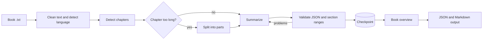

<h1 align="center">Chapterly</h1>

<p align="center">
  <b>Structured, chapter-by-chapter summaries of long books, powered by large language models.</b><br>
  English and Persian &middot; resumable &middot; validated output &middot; cost reporting
</p>

<p align="center">
  
  
  
  
</p>


<div align="center">
  
</div>

<hr>

## Overview

Chapterly takes a book as a plain-text file, detects its chapters, and produces a validated **JSON** document and a readable **Markdown** report containing a summary of the whole book, a summary of every chapter, and a breakdown of each chapter into sections. A web interface lets you choose a book, estimate the cost, follow progress, and read the result.

The core of the project is a pipeline that stays reliable on long inputs: it respects model input and output limits, preserves continuity between chapters, survives API failures, and resumes after interruption without repeating finished work.

## Features

<table>
  <tr>
    <td width="26%"><b>Structure detection</b></td>
    <td>Finds chapters from the real text, in English and Persian, ignores tables of contents, and checks that chapters cover the text exactly once.</td>
  </tr>
  <tr>
    <td><b>Continuity</b></td>
    <td>A rolling "story so far" and a character list are carried from chapter to chapter, so names and relationships stay consistent.</td>
  </tr>
  <tr>
    <td><b>Long chapters</b></td>
    <td>Chapters above a token limit are split at paragraph boundaries, summarized in order, and merged, with no overlap and no gaps.</td>
  </tr>
  <tr>
    <td><b>Checkpointing</b></td>
    <td>Every step is saved. An interrupted run continues from the last finished step; changed prompts or models invalidate old results automatically.</td>
  </tr>
  <tr>
    <td><b>Error handling</b></td>
    <td>Exponential backoff for rate limits, server errors and network failures; invalid or truncated model JSON is validated and requested again.</td>
  </tr>
  <tr>
    <td><b>Validation</b></td>
    <td>Model answers and the final book document are checked against schemas, and each chapter's sections must cover all of its paragraphs.</td>
  </tr>
  <tr>
    <td><b>Observability</b></td>
    <td>Per-book status file, error log, and a per-call usage log with a cost report based on your own token prices.</td>
  </tr>
  <tr>
    <td><b>Persian support</b></td>
    <td>Persian text normalization, Persian summaries, and a right-to-left reader.</td>
  </tr>
</table>

## How it works



## Getting started

### Prerequisites

Node.js 20.6 or newer (the current LTS release is recommended), installed from [nodejs.org](https://nodejs.org). Verify with:

```bash
node -v
npm -v
```

### 1. Backend (summarizer and API)

```bash
cd src/book-summarizer
npm install
```

Create your configuration file from the template (`copy` on Windows, `cp` on macOS and Linux):

```bash
copy .env.example .env
```

Then edit `.env`. See [Configuration](#configuration). To try the whole application without spending anything, set `LLM_PROVIDER=mock`; the mock provider returns fake summaries.

Start the API server:

```bash
npm run server
```

The API listens on `http://localhost:8787` and shows a status page at that address.

### 2. Frontend

In a second terminal, from the repository root:

```bash
npm install
npm run dev
```

Open the address printed in the terminal (normally `http://localhost:8080`).

<div align="center">
  
</div>

## Usage

### Web interface

1. Choose a book from the library, or add a `.txt` file to `src/book-summarizer/data/`.
2. Review the estimated tokens and cost, choose the summary language, and start.
3. Follow the chapter-by-chapter progress. If a run stops, start it again and it resumes.
4. Read the result in the app and download the JSON or Markdown file.

<div align="center">
  
</div>

### Command line

Run these from `src/book-summarizer`.

```bash
# Inspect structure, token estimate and plan (no API calls)
node src/cli.js inspect data/dorian-gray.txt

# Summarize; --limit processes only the first N chapters
node --env-file=.env src/cli.js summarize data/dorian-gray.txt --title "The Picture of Dorian Gray" --limit 2

# Split chapters above a token limit into parts
node --env-file=.env src/cli.js summarize data/dorian-gray.txt --title "The Picture of Dorian Gray" --maxChunkTokens 3000

# Token and cost report for a finished run
node --env-file=.env scripts/report.js output/dorian-gray.json

# Run the tests (no API calls)
npm test
```

Add `--force` to ignore checkpoints and start from scratch.

## Configuration

Settings live in `src/book-summarizer/.env`. This file is ignored by Git; never commit it.

<table>
  <tr><th align="left">Variable</th><th align="left">Description</th></tr>
  <tr><td><code>LLM_PROVIDER</code></td><td><code>openrouter</code>, <code>gemini</code> or <code>mock</code></td></tr>
  <tr><td><code>LLM_MODEL</code></td><td>Model identifier, for example a <code>google/gemini-...</code> model from openrouter.ai/models</td></tr>
  <tr><td><code>OPENROUTER_API_KEY</code></td><td>API key when the provider is <code>openrouter</code></td></tr>
  <tr><td><code>GEMINI_API_KEY</code></td><td>API key when the provider is <code>gemini</code></td></tr>
  <tr><td><code>STRUCTURED_MODE</code></td><td><code>json_schema</code>, <code>json_object</code> or <code>prompt</code>; use a weaker mode for models without strict structured output</td></tr>
  <tr><td><code>LLM_INPUT_PRICE</code></td><td>Price in USD per million input tokens, used by cost estimates and the report</td></tr>
  <tr><td><code>LLM_OUTPUT_PRICE</code></td><td>Price in USD per million output tokens</td></tr>
  <tr><td><code>PORT</code></td><td>API port (default <code>8787</code>)</td></tr>
</table>

Setting `VITE_DEMO_MODE=true` for the frontend makes it run on built-in demo data without a backend.

## Output

For every book, `src/book-summarizer/output/<book>.json` contains the book information, the overview, every chapter with its sections (each with a paragraph range), token usage per chapter, and warnings. The matching `.md` file is the same content as a readable report. Progress and diagnostics are written to `src/book-summarizer/.state/<book>/` (`status.json`, `errors.jsonl`, checkpoints) and `.state/usage.jsonl` (one line per model call).

## Project structure

<details>
<summary><b>Show the directory layout</b></summary>

```
chapterly/
  src/                        React frontend (library, progress, reader, summaries)
    lib/api/                  backend client; demo mode with VITE_DEMO_MODE=true
  src/book-summarizer/        the summarizer (plain Node.js)
    data/                     input .txt books
    output/                   generated JSON and Markdown (ignored by Git)
    .state/                   checkpoints, status, error and usage logs (ignored by Git)
    scripts/report.js         token and cost report
    test/                     Vitest tests that use fake providers
    src/
      cli.js                  command-line interface
      server.js               HTTP API used by the frontend
      pipeline.js             orchestrates a run
      extract/                text loading and cleaning, language detection
      structure/              chapter detection, paragraph numbering
      llm/                    providers, retry, usage log, validated generation, token estimates
      summarize/              prompts, chapter and overview logic, long-chapter splitting
      schema/                 Zod schemas and final-output validation
      state/                  checkpoints and error log
```

</details>

## Testing

The test suite uses fake providers only, so it needs no network and costs nothing. It covers rate limits (429), server errors (503), network and permanent failures, invalid or truncated JSON, wrong section ranges, interrupted runs and resume, corrupted checkpoints, oversized chapters, invalid final output, and cost reporting.

```bash
cd src/book-summarizer
npm test
```